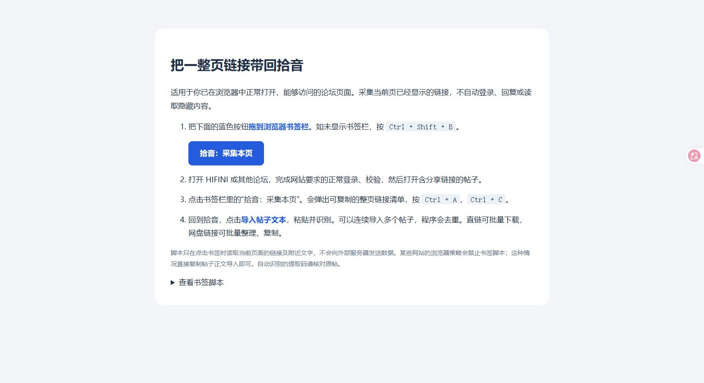

<div align="center">


# 拾音 · Shiyin

**发现下一张心动专辑，把零散分享整理成一张清单。**

Windows 桌面音乐发现与公开分享链接整理工具。分类推荐、多站查询、网盘链接整理、直链队列下载，配上温暖的狐狸主题界面。

`Python 3.11+` · `Tkinter` · `Windows 10 / 11` · `v1.6`

</div>

[下载 v1.6 完整工程 ZIP](shiyin-music-v1.6-project.zip)

## 界面预览

### 发现音乐

奶油白与森林绿配色，原创小狐狸插画、圆角推荐卡片和爪印装饰。


界面截图展示狐狸主题。推荐卡片来自内置主题库，实际搜索结果取决于来源网站的访问状态。

### 浏览器采集助手



## 可以做什么

| 功能 | 说明 |
| --- | --- |
| 音乐发现 | 48 个精选作品、歌手主题；按方向、风格、心情组合筛选 |
| 随机推荐 | 换一批、随便来一个、收藏喜欢的主题，一键带入查询 |
| 多来源查询 | 内置 15 个论坛或分享站，可自定义地址并保存勾选 |
| 公开链接整理 | 提取常见音频、压缩包直链与网盘分享，识别附近提取码 |
| 下载队列 | 直链并发下载、重复文件跳过、服务器支持时断点续传 |
| 自动歌词 | 下载完成后匹配 LRCLIB；同步歌词存 LRC，纯文本存 TXT，已有歌词保留 |
| 本地补歌词 | 添加已有音频或扫描下载目录，多选批量处理；不确定版本可手动预览选择 |
| 百度分享下载 | 调用 BaiduPCS-Go，批量转存、下载、停止与续传，工具可一键安装并校验 |
| 每轮独立 | 新查询正式启动时自动清空上轮结果，保留下载文件与收藏 |
| 清单管理 | 复制链接和提取码、导出 CSV、手动导入可访问的帖子文本 |
| 访问反馈 | 区分相关帖子、网盘与直链，显示超时、校验和隐藏内容限制 |

推荐为本地编辑主题库与随机选择，不是实时榜单，也不读取收听记录。程序不会把文件后缀当作真实无损音质的证明。

## 快速开始

运行环境：Windows 10 / 11、Python 3.11 或更高版本（包含 Tkinter），以及 Windows 自带的 `curl.exe`。TinyTag 用于只读解析音频标签与时长。

1. 下载工程 ZIP 并解压，或者克隆仓库。
2. 安装 [Python](https://www.python.org/downloads/windows/)，确保能使用 `py` 或 `python` 命令。
3. 在工程目录安装依赖后启动；以后可双击 `启动拾音.cmd`：

```powershell
python -m pip install -r requirements.txt
python music_collector.pyw
```

4. 在“发现音乐”挑选推荐，或切换“搜集与下载”填写歌手、专辑、歌名。
5. 通过“内置网站”勾选来源，点击“开始搜集”。
6. 直链可以加入下载队列；百度分享可到“歌词与网盘”批量下载，其他网盘用浏览器打开。

## 歌词与百度网盘（1.6 新增）

在“歌词与网盘”中，默认开启下载后自动补歌词。支持 TinyTag 可识别的音频标签与时长；缺少标签时尝试解析 `歌手 - 歌名` 文件名。自动匹配要求歌名、歌手一致，已有专辑与时长信息也必须相符（时长差不超过 3 秒）。多个歌词版本无法区分时不自动保存，可以选择文件后用“手动匹配所选”修改查询、预览并保存。

歌词来自 [LRCLIB 公共接口](https://lrclib.net/docs)。只在音频旁创建同名 `.lrc` 或 `.txt`，不修改音频本身，不覆盖已有同名歌词。查询会向 LRCLIB 发送歌名、歌手信息；可关闭自动查询。纯音乐不创建空歌词。压缩包不会自动解压，解压后可扫描目录补歌词。资料库覆盖率与服务可用性会影响结果。

百度网盘调用 [qjfoidnh/BaiduPCS-Go](https://github.com/qjfoidnh/BaiduPCS-Go)（MIT）作为独立进程，不复制或修改其源码。使用方法：

1. 点击“一键安装开源工具”：从官方 GitHub Release 获取对应 Windows 版本，验证官方资产 SHA-256 后安装到本机应用数据目录；也可选择已有工具。
2. 打开“登录 / 账号终端”，按上游项目说明完成登录，再输入 `quit` 退出终端，点击“检测登录”。账号终端由上游工具提供；部分普通登录方式已不维护，具体可用方式以上游文档为准。
3. 在“搜集与下载”清单中选择百度分享（可多选），再点击“下载清单中的百度分享”；未选中时处理全部百度分享。
4. 程序把每个分享转存到自己网盘的 `/拾音下载/分享编号`，下载到指定本地目录的 `百度_分享编号` 中。停止后文件与转存记录保留，重新运行可续传。不会自动删除远端转存文件。

拾音为工具设置独立的 `BAIDUPCS_GO_CONFIG_DIR`，不读取浏览器登录数据，也不接收或记录 BDUSS、STOKEN、Cookie。百度账号认证信息由上游工具保存在本机应用数据目录的 `baidupcs` 子目录中，不能分享给别人或提交到仓库。开源工具未打包进源码 ZIP，首次使用需联网安装。

**需要自己的百度网盘账号、可访问的分享和正确提取码。** 不提供免登录下载或会员加速，实际速度与可用性由百度和上游工具决定。网盘工具报错、零字节结果、未确认转存成功时不会显示下载完成。真实账号的端到端下载需要用户在本机登录后验证。

首次启动默认检查最多 100 页，同一轮最多并行查询 4 个来源，目标总时限 120 秒。首轮分配各站额度，之后将剩余额度优先交给已找到公开链接的网站。

## 支持的来源

内置 HIFINI、HiFi 听吧、读屏族、Hi-Res 视听发烧论坛、捌零、享乐、海水之声、23APE、XDOUBAN、动感炫音、CD包子铺、优歌、挖音乐、乐海拾贝、熊猫无损音乐网。

**内置地址不代表全部完成专站适配或保证可下载。** 公开 HTML 页面使用通用解析器与现有搜索表单；网站更换域名、搜索权限、登录、回复可见、积分或会员要求都会影响结果。程序尊重 robots.txt，不自动登录、回复或处理验证码。遇到浏览器校验时，可以正常访问页面后用辅助书签整理当前可见链接。

识别 FLAC、APE、WAV、ALAC、AIFF、WV、TTA、TAK、DSF、DFF 及 ZIP / RAR / 7Z 显式直链，以及常见百度、夸克、阿里、迅雷、123、115、蓝奏、微云、城通等分享域名。压缩包不会自动解压；隐藏附件与无扩展名下载接口不保证识别。

## 数据与隐私

配置、收藏、链接清单及运行日志保存在 `%LOCALAPPDATA%\MusicLinkCollector`。下载目录由用户选择。程序不读取浏览器密码、Cookie 或其他音乐软件数据。

工程不包含个人配置、真实下载清单、提取码、音乐文件或已打包的个人运行日志。截图中的发现页使用内置主题；辅助页面不涉及用户账号。

## 工程结构

```text
shiyin-music/
├─ music_collector.pyw       # 应用入口、界面与采集下载逻辑
├─ music_extras.py           # 歌词匹配、只读标签解析、网盘进程桥接
├─ music_extras_ui.py        # 歌词与网盘界面
├─ 启动拾音.cmd             # 通用 Windows 启动入口
├─ build.ps1                # 可选 EXE 构建脚本
├─ requirements.txt         # 音频标签解析依赖 TinyTag
├─ requirements-build.txt   # 可选构建依赖
├─ 浏览器采集助手.html      # 当前可见网页链接整理书签
├─ assets/                  # 原创狐狸透明插画与生成说明
├─ docs/                    # 使用说明和界面截图
└─ tests/                   # 本地测试，不下载真实音乐
```

## 运行测试

在有桌面环境的 Windows 中运行：

```powershell
python -m unittest discover -s tests -v
```

32 项测试覆盖公开页面链接提取、搜索表单、来源额度、超时与停止、去重、文件续传、自动清空、配置迁移、推荐收藏，以及歌词版本匹配、原文件保护、下载后歌词交接、网盘进程取消、零退出码报错、账号检测、转存续传和工具校验。测试使用本机模拟 HTTP 服务、临时配置和生成的测试字节，不需要音乐或网盘账号。真实百度账号下载未作端到端验证。

## 可选：构建 Windows EXE

```powershell
python -m pip install -r requirements-build.txt
python -m pip install -r requirements.txt
powershell -File .\build.ps1
```

构建产物在 `dist` 中。未签名 EXE 可能被本机应用控制策略拦截；此时仍可使用源码入口，无需更改系统策略。运行依赖与素材均通过工程相对路径定位，不依赖作者电脑目录。

详细使用方法见 [用户指南](docs/USER_GUIDE.md)，插画来源和生成提示见 [素材说明](assets/生成说明.md)。
